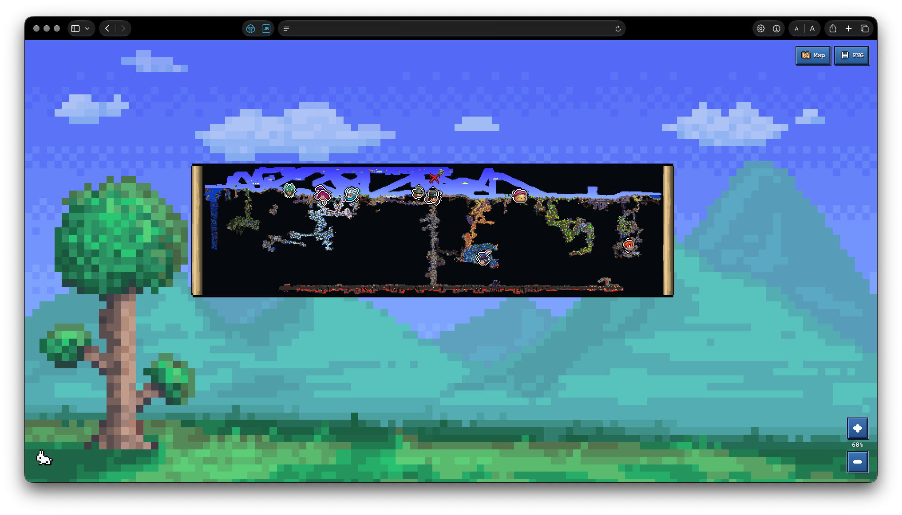

<div align="center">
  <h1 align="center"> tMapOnline</h1>
  <p><strong>une carte Terraria en ligne et en temps réel – le monde partagé et tout ce qui s’y passe maintenant.</strong></p>
  <p>exploration du monde · joueurs et PNJ · boss · itinéraires · Map Ping entre le navigateur et le jeu</p>
  <p><a href="README.md">🇺🇸 English</a> · <a href="README_RU.md">🇷🇺 Русский</a> · <a href="README_UK.md">🇺🇦 Українська</a> · <a href="README_FR.md">🇫🇷 Français</a> · <a href="README_JA.md">🇯🇵 日本語</a> · <a href="README_ZH_CN.md">🇨🇳 简体中文</a> · <a href="README_KO.md">🇰🇷 한국어</a></p>
</div>

on jouait à Terraria avec des amis. l’un d’eux adorait découvrir de nouveaux endroits, explorer les biomes et construire des maisons. un jour, il m’a demandé : « est-ce qu’on pourrait voir sur une seule carte ce que tous les joueurs ont exploré ? » je n’ai pas trouvé de carte prête à l’emploi qui réunisse la progression de l’équipe et les événements du monde en temps réel, alors j’ai décidé d’essayer d’en créer une. c’est comme ça qu’est né tMapOnline.

au début, c’était une simple page d’état du serveur : depuis combien de temps il tournait et combien de mémoire il utilisait. ensuite sont arrivés les joueurs, les PNJ, les boss et leurs sprites. la carte est venue après. maintenant, je peux l’ouvrir dans un navigateur et aider un ami depuis mon téléphone : je place un Map Ping et il apparaît dans sa partie. pas besoin de lancer Terraria de mon côté.

## ce qu’on voit sur la carte



- l’exploration commune du monde et les itinéraires des joueurs sur la période définie dans la configuration du serveur ;
- les joueurs, les têtes des PNJ et des boss, les pylônes, les pièces, le point d’apparition, les morts et Map Ping ;
- les changements de blocs en direct et un assombrissement doux des zones inexplorées, influencé par la lumière ;
- les arrière-plans de Terraria, un menu pixelisé et des infobulles, y compris sur téléphone ;
- l’historique des joueurs et des sessions, la progression des boss, l’état du serveur, sa charge et les événements regroupés.

la carte utilise les sprites du jeu pour les joueurs , les têtes des PNJ  et les boss – par exemple le Mur de chair . Les pylônes , les pièces d’or , le point d’apparition , les lieux de mort  et Map Ping  utilisent aussi leurs sprites du jeu.

les réglages d’affichage appartiennent à chaque navigateur. tu peux choisir les joueurs et les couches visibles, activer les itinéraires ou modifier l’animation. Ces préférences restent dans le `localStorage` de ce navigateur et ne changent pas ce que voient les autres. Le propriétaire du serveur règle l’adresse du service, la fréquence des mises à jour, la durée de conservation et les fonctions disponibles dans le fichier YAML.

## démarrage

il faut Python 3.9 ou une version plus récente. Installe tModLoader si tu veux aussi démarrer un serveur de jeu local avec tMapOnline. Node.js ne sert qu’à compiler l’interface web.

commence par compiler les fichiers web. Le dossier généré `tmaponline/web/assets` n’est pas conservé dans Git ; la compilation le crée :

```sh
npm ci
npm run build
```

installe ensuite tMapOnline et copie la configuration d’exemple :

```sh
python3 -m venv .venv
. .venv/bin/activate
python3 -m pip install -e .
cp config.example.yaml config.local.yaml
```

pour lancer la carte avec un serveur Terraria local :

```sh
tmaponline --config config.local.yaml run
```

si le serveur est géré séparément, lance uniquement le service web :

```sh
tmaponline --config config.local.yaml serve
```

ouvre l’adresse indiquée par `server.host` et `server.port` ; par défaut, `http://127.0.0.1:8765`. La commande `run` démarre le serveur indiqué dans la configuration. Si un autre processus utilise déjà son port, tMapOnline ne l’arrête pas.

### mod serveur

le mod doit être installé uniquement dans le profil tModLoader du serveur ; les joueurs n’ont pas besoin de l’installer. Il envoie les données du monde au service web et transmet aux joueurs les Map Ping créés dans le navigateur.

compile le mod avec la même version de tModLoader que celle du serveur :

```sh
TML_ROOT="/path/to/tModLoader" python3 tools/build-mod.py
```

le script crée `dist/tMapOnline.tmod`, sans remplacer le mod d’un serveur en cours d’exécution. Copie le fichier dans le dossier Mods du profil serveur et active `tMapOnline`. Redémarre le serveur seulement quand personne ne joue.

## configuration et données

la configuration d’exemple se trouve dans [config.example.yaml](config.example.yaml). La documentation technique détaillée est disponible en français : [configuration du serveur](docs/fr/configuration.md), [architecture](docs/fr/architecture.md), [carte web](docs/fr/web-map.md), [mod serveur](docs/fr/mod.md), [télémétrie et API HTTP](docs/fr/telemetry.md), [mise à jour](docs/fr/migration.md).

par défaut, les données sont stockées dans `~/Library/Application Support/tMapOnline` : cache de la carte, historique des joueurs, cartes importées et progression des boss. Modifie `storage.data_dir` dans la configuration serveur pour changer le dossier.

## licence et attribution

le code source est distribué sous licence MIT. Tu peux l’utiliser, le modifier, l’inclure dans un projet commercial et le redistribuer. Si tu crées un fork ou un projet basé sur tMapOnline, conserve le fichier [LICENSE](LICENSE) et un lien vers [le code source sur GitHub](https://github.com/MakStashkevich/tMapOnline).

certains éléments ont leurs propres conditions. Par exemple, [LICENSE-lzx.txt](tmaponline/sprite_renderer/LICENSE-lzx.txt) concerne le composant LZX, pas tout le projet. Vérifie les licences des images, des polices et des outils tiers avant de les redistribuer.
