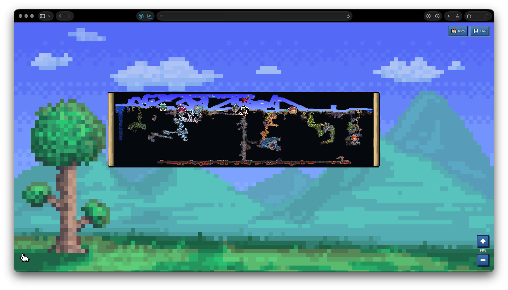

<div align="center">
  <h1 align="center"> tMapOnline</h1>
  <p><strong>リアルタイムで見られるTerrariaのオンラインマップ。みんなで共有する世界と、今起きていることを表示します。</strong></p>
  <p>ワールド探索 · プレイヤーとNPC · ボス · 移動ルート · ブラウザーとゲーム間のMap Ping</p>
  <p><a href="README.md">🇺🇸 English</a> · <a href="README_RU.md">🇷🇺 Русский</a> · <a href="README_UK.md">🇺🇦 Українська</a> · <a href="README_FR.md">🇫🇷 Français</a> · <a href="README_JA.md">🇯🇵 日本語</a> · <a href="README_ZH_CN.md">🇨🇳 简体中文</a> · <a href="README_KO.md">🇰🇷 한국어</a></p>
</div>

友だちとTerrariaを遊んでいたとき、友だちの一人が新しい場所やバイオームを探したり、家を建てたりするのが大好きでした。ある日、「全員が探索した場所を一つのマップで見られないかな？」と聞かれました。チーム全体の探索状況と、ワールドで今起きていることをリアルタイムで見られる既製のマップが見つからなかったので、自分で作ってみることにしました。こうしてtMapOnlineが始まりました。

最初はサーバーの稼働時間やメモリ使用量を見るだけのページでした。その後、プレイヤー、NPC、ボスとそのスプライトを追加し、最後にマップができました。今はブラウザーでマップを開き、スマートフォンから友だちを手伝えます。Map Pingを置くと、相手のゲームにも表示されます。自分でTerrariaを起動する必要はありません。

## マップに表示されるもの



- サーバー設定で指定した期間の、チーム共通の探索状況とプレイヤーの移動ルート
- プレイヤー、NPCとボスの頭部、ピラー、コイン、スポーン地点、死亡地点、Map Ping
- タイルのリアルタイム更新と、光の影響を受ける滑らかな未探索エリアの暗転
- Terrariaの背景テクスチャ、ピクセル風メニュー、スマートフォンでも使えるツールチップ
- プレイヤーとセッションの履歴、ボスの進行状況、サーバー状態、負荷、まとめられたイベント

プレイヤー 、NPCの頭部 、ボス（たとえばWall of Flesh ）にはゲーム内のスプライトを使います。ピラー 、金貨 、スポーン地点 、死亡地点 、Map Ping も同じです。

表示設定はブラウザーごとに保存されます。表示するプレイヤーやレイヤー、ルート、アニメーションを選べます。設定はそのブラウザーの`localStorage`に保存され、ほかの人の表示には影響しません。サービスのアドレス、更新頻度、データ保存期間、利用できる機能はサーバー所有者がYAML設定で決めます。

## 起動方法

Python 3.9以降が必要です。tMapOnlineからローカルのゲームサーバーも起動する場合はtModLoaderをインストールしてください。Node.jsはWebインターフェースのビルドにだけ使います。

まずWebファイルをビルドします。`tmaponline/web/assets`はビルド時に生成されるため、Gitには含まれません。

```sh
npm ci
npm run build
```

次にtMapOnlineをインストールして、サンプル設定をコピーします。

```sh
python3 -m venv .venv
. .venv/bin/activate
python3 -m pip install -e .
cp config.example.yaml config.local.yaml
```

ローカルのTerrariaサーバーとマップを一緒に起動する場合：

```sh
tmaponline --config config.local.yaml run
```

ゲームサーバーを別に管理している場合はWebサービスだけを起動します。

```sh
tmaponline --config config.local.yaml serve
```

`server.host`と`server.port`のアドレスを開きます。初期設定では`http://127.0.0.1:8765`です。`run`は設定ファイルに書かれたゲームサーバーも起動します。ポートを別のプロセスが使用中でも、tMapOnlineがそのプロセスを停止することはありません。

### サーバーモッド

モッドはサーバー側のtModLoaderにだけ必要です。プレイヤーはインストールしなくてかまいません。モッドはワールド情報をWebサービスに送り、ブラウザーからのMap Pingを接続中のプレイヤーに転送します。

サーバーと同じバージョンのtModLoaderを指定してビルドします。

```sh
TML_ROOT="/path/to/tModLoader" python3 tools/build-mod.py
```

ビルドスクリプトは`dist/tMapOnline.tmod`を作成します。稼働中のサーバーにあるモッドは置き換えません。パッケージをサーバープロファイルのModsフォルダーにコピーし、`tMapOnline`を有効にしてください。サーバーの再起動は、プレイヤーがいないときだけ行ってください。

## 設定とデータ

設定例は[config.example.yaml](config.example.yaml)にあります。詳しい技術ドキュメントは日本語で読めます：[サーバー設定](docs/ja/configuration.md)、[アーキテクチャ](docs/ja/architecture.md)、[Webマップ](docs/ja/web-map.md)、[サーバーモッド](docs/ja/mod.md)、[テレメトリとHTTP API](docs/ja/telemetry.md)、[更新方法](docs/ja/migration.md)。

デフォルトでは`~/Library/Application Support/tMapOnline`にデータを保存します。マップキャッシュ、プレイヤー履歴、インポートしたマップ、ボスの進行状況が含まれます。保存先はサーバーYAMLの`storage.data_dir`で変更できます。

## ライセンスとクレジット

ソースコードはMIT Licenseで公開しています。利用、改変、商用プロジェクトへの組み込み、再配布ができます。フォークや派生プロジェクトを作る場合は、[LICENSE](LICENSE)ファイルと[tMapOnlineのGitHubソース](https://github.com/MakStashkevich/tMapOnline)へのリンクを残してください。

一部の素材には個別の利用条件があります。たとえば[LICENSE-lzx.txt](tmaponline/sprite_renderer/LICENSE-lzx.txt)はLZXコンポーネントのライセンスで、プロジェクト全体のライセンスではありません。画像、フォント、外部ツールを再配布する前に、それぞれのライセンスを確認してください。
