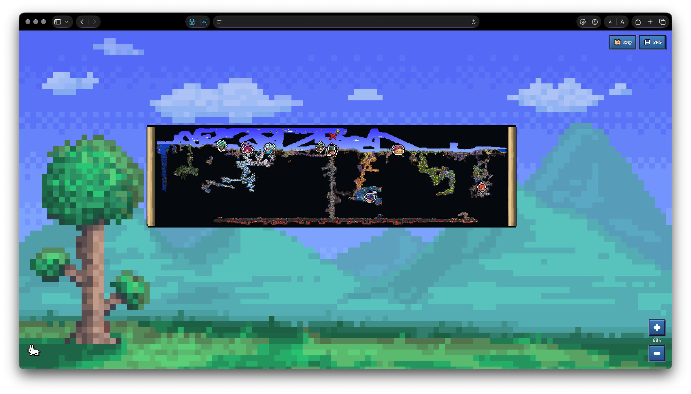
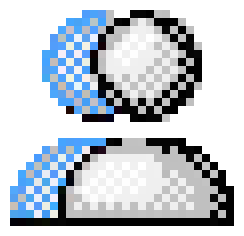

<div align="center">
  <h1 align="center"> tMapOnline</h1>
  <p><strong>실시간 온라인 Terraria 지도 – 모두가 공유하는 세계와 지금 일어나는 일을 보여줍니다.</strong></p>
  <p>월드 탐험 · 플레이어와 NPC · 보스 · 이동 경로 · 브라우저와 게임 간 Map Ping</p>
  <p><a href="README.md">🇺🇸 English</a> · <a href="README_RU.md">🇷🇺 Русский</a> · <a href="README_UK.md">🇺🇦 Українська</a> · <a href="README_FR.md">🇫🇷 Français</a> · <a href="README_JA.md">🇯🇵 日本語</a> · <a href="README_ZH_CN.md">🇨🇳 简体中文</a> · <a href="README_KO.md">🇰🇷 한국어</a></p>
</div>

친구들과 Terraria를 하던 중 한 친구가 새로운 장소와 바이옴을 찾고 집을 짓는 걸 정말 좋아했습니다. 어느 날 그 친구가 물었습니다. “모든 플레이어가 탐험한 곳을 한 지도에서 볼 수 있을까?” 팀의 탐험 진행 상황과 월드에서 벌어지는 일을 실시간으로 보여주는 지도를 찾지 못해 직접 만들어 보기로 했습니다. 그렇게 tMapOnline이 시작됐습니다.

처음에는 서버가 얼마나 오래 실행됐는지, 메모리를 얼마나 쓰는지 보여주는 간단한 페이지였습니다. 그다음 플레이어, NPC, 보스와 스프라이트를 추가했고, 지도는 나중에 만들었습니다. 이제 브라우저에서 월드를 보고 휴대폰으로 친구를 도울 수 있습니다. Map Ping을 찍으면 친구의 게임에도 표시됩니다. 제가 Terraria를 직접 실행할 필요가 없습니다.

## 지도에서 볼 수 있는 것



- 서버 설정 기간에 따른 팀 공통 탐험 진행 상황과 플레이어 이동 경로;
- 플레이어, NPC 및 보스 머리, 수정 기둥, 동전, 스폰 지점, 사망 표시, Map Ping;
- 실시간 타일 변경과 조명에 따라 부드럽게 어두워지는 미탐험 영역;
- Terraria 배경 텍스처, 픽셀 스타일 메뉴와 툴팁, 휴대폰 화면 지원;
- 플레이어 및 세션 기록, 보스 진행 상황, 서버 상태와 부하, 묶어서 표시하는 이벤트.

지도는 플레이어 , NPC 머리 , 보스(예: 월 오브 플레시 )에 게임 스프라이트를 사용합니다. 수정 기둥 , 금화 , 스폰 지점 , 사망 위치 , Map Ping 도 같은 방식으로 표시됩니다.

표시 설정은 브라우저마다 따로 저장됩니다. 표시할 플레이어와 레이어, 경로, 애니메이션을 선택할 수 있습니다. 설정은 해당 브라우저의 `localStorage`에 저장되며 다른 플레이어의 화면에는 영향을 주지 않습니다. 서버 주소, 업데이트 주기, 데이터 보관 기간과 기능 사용 여부는 서버 소유자가 YAML 설정에서 지정합니다.

## 실행하기

Python 3.9 이상이 필요합니다. tMapOnline에서 로컬 게임 서버도 실행하려면 tModLoader를 설치하세요. Node.js는 웹 인터페이스를 빌드할 때만 필요합니다.

먼저 웹 파일을 빌드합니다. `tmaponline/web/assets`는 빌드 과정에서 생성되며 Git에 저장되지 않습니다.

```sh
npm ci
npm run build
```

그다음 tMapOnline을 설치하고 예제 설정 파일을 복사합니다.

```sh
python3 -m venv .venv
. .venv/bin/activate
python3 -m pip install -e .
cp config.example.yaml config.local.yaml
```

로컬 Terraria 서버와 웹 지도를 함께 실행하려면:

```sh
tmaponline --config config.local.yaml run
```

게임 서버를 별도로 관리한다면 웹 서비스만 실행합니다.

```sh
tmaponline --config config.local.yaml serve
```

`server.host`와 `server.port`에 설정된 주소를 여세요. 기본 주소는 `http://127.0.0.1:8765`입니다. `run` 명령은 설정 파일에 지정된 게임 서버도 실행합니다. 해당 포트를 다른 프로세스가 사용 중이어도 tMapOnline은 그 프로세스를 종료하지 않습니다.

### 서버 모드

모드는 서버의 tModLoader에만 설치하면 됩니다. 플레이어는 설치할 필요가 없습니다. 모드는 월드 데이터를 웹 서비스로 보내고 브라우저에서 보낸 Map Ping을 접속 중인 플레이어에게 전달합니다.

서버와 같은 tModLoader 버전을 사용해 모드를 빌드하세요.

```sh
TML_ROOT="/path/to/tModLoader" python3 tools/build-mod.py
```

빌드 스크립트는 `dist/tMapOnline.tmod`를 생성하며 실행 중인 서버의 모드를 바꾸지 않습니다. 파일을 서버 프로필의 Mods 폴더에 복사하고 `tMapOnline`을 활성화하세요. 플레이어가 없을 때만 서버를 다시 시작하세요.

## 설정과 데이터

예제 서버 설정은 [config.example.yaml](config.example.yaml)에 있습니다. 자세한 기술 문서는 한국어로 제공됩니다: [서버 설정](docs/ko/configuration.md), [구조](docs/ko/architecture.md), [웹 지도](docs/ko/web-map.md), [서버 모드](docs/ko/mod.md), [텔레메트리 및 HTTP API](docs/ko/telemetry.md), [업데이트](docs/ko/migration.md).

기본적으로 데이터는 `~/Library/Application Support/tMapOnline`에 저장됩니다. 여기에는 지도 캐시, 플레이어 기록, 가져온 지도와 보스 진행 상황이 들어 있습니다. 서버 YAML의 `storage.data_dir`로 경로를 바꿀 수 있습니다.

## 라이선스와 출처

소스 코드는 MIT License로 공개됩니다. 사용, 수정, 상업 프로젝트에 포함, 재배포가 가능합니다. 포크하거나 tMapOnline 기반 프로젝트를 만든다면 [LICENSE](LICENSE) 파일과 [GitHub 소스 저장소 링크](https://github.com/MakStashkevich/tMapOnline)를 남겨 주세요.

일부 리소스에는 별도의 조건이 있습니다. 예를 들어 [LICENSE-lzx.txt](tmaponline/sprite_renderer/LICENSE-lzx.txt)는 LZX 구성요소에 적용되며 프로젝트 전체에 적용되는 라이선스는 아닙니다. 이미지, 글꼴, 외부 도구를 재배포하기 전에 각각의 라이선스를 확인하세요.
